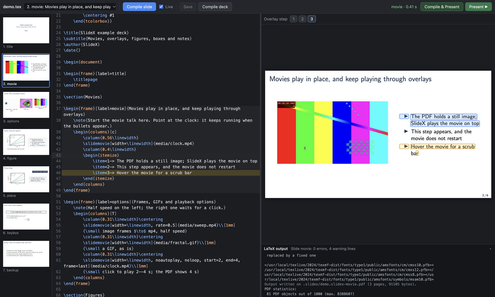

# SlideX documentation

SlideX is a presenter for PDF slides, made for beamer decks, with a LaTeX
editor built in. Any PDF presents as it is, and any beamer deck edits as it
is; the `slidemovie` package is only for movies. These pages walk through it with the example deck in
[`example/`](../example), so every screenshot can be reproduced.



| Page | What it covers |
|---|---|
| [Presenting](presenting.md) | opening a deck, keys, the presenter window, laser, magnifier, slide panel, speaker notes |
| [Movies and GIFs](movies.md) | the `slidemovie` package: putting a movie on a slide, options, posters, sending a deck |
| [The editor](editor.md) | one-slide compiles, two-way highlighting, completion, resizing and moving, captions, text editing, errors, themes |
| [Line-by-line highlighting](frames.md) | how the editor matches source lines and slides, and which frames it can |

## Try it with the example deck

The example deck is plain beamer, with six slides and a backup slide: a movie that keeps
playing through overlay steps, three movies with different options, a figure
next to a box, a slide for moving things (a figure, a box and a TikZ node), a
box macro with an equation, and a backup slide.

1. Install SlideX (see [Install](../README.md#install)), or run it from source
   (see [Building](../README.md#building)).
2. Open `example/demo.pdf` (File > Open) and press `f` for full screen.
3. Press Cmd-E to open its source, `example/demo.tex`, in the editor.

To build the deck yourself, see the comment at the top of
[`example/demo.tex`](../example/demo.tex). The example's media come from
ffmpeg's test sources and from [`example/figures/make_figures.py`](../example/figures/make_figures.py).

## Remaking the screenshots

The screenshots are made by SlideX itself, driving the example deck off screen:

```bash
cd app
npm run sync-viewer
node_modules/.bin/electron . --shots ../docs/images ../example/demo.pdf
```

Your source file is never saved during this run; edits shown in the shots are
undone afterwards.
