# The editor

[Documentation](README.md) > The editor

SlideX can open a deck's LaTeX source next to its slides. Open a deck, then
File > Edit Source of This Deck (Cmd-E) or **Edit** in the deck's toolbar:
the editor opens the `.tex` with the same name as the PDF. File > Open LaTeX
Source (Shift-Cmd-O) starts from a `.tex` instead, and builds it first if its
PDF is missing or older.

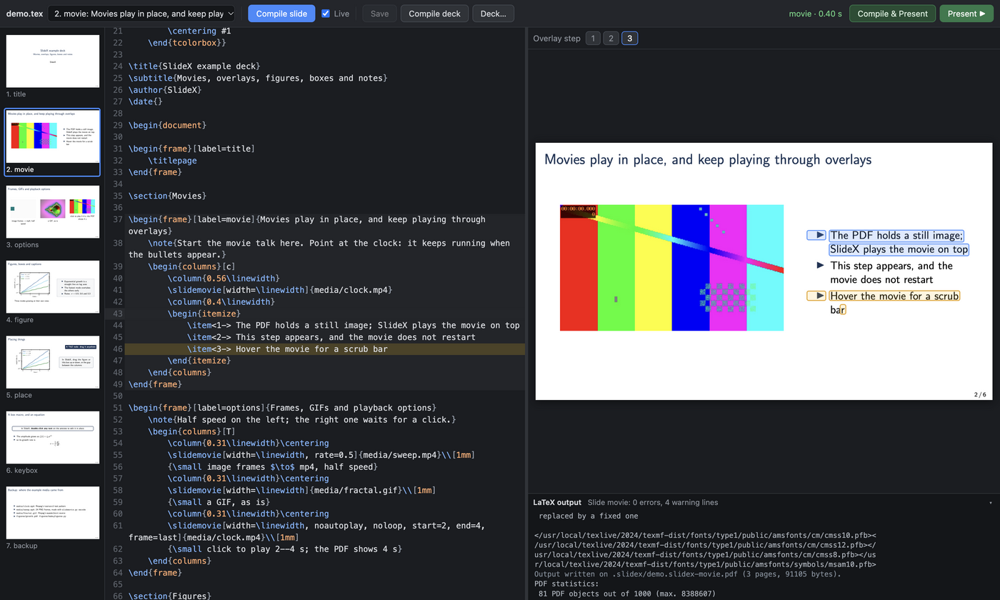

From left to right: the **slide strip** (one thumbnail per frame, from the
last full build; click one to go there), the **source**, and the **preview**
of the frame under the cursor, with its overlay steps above it and the LaTeX
output below.

## One slide at a time

Cmd-Enter (or **Compile slide**) compiles only the frame under the cursor,
from the text in the editor: your file is not saved. A slide takes about half
a second. With **Live** on, the slide recompiles half a second after you stop
typing.

- **Save** (Cmd-S) writes the file. Before the first save in a session the
  original is copied to `.slidex/backups/`.
- **Compile deck** (Shift-Cmd-Enter) saves and builds the whole deck,
  then redraws the strip and reloads the deck window.
- **Compile & Present** saves, builds, and switches to presenting.
  **Present** switches straight away, on the same slide, with the deck as last
  built. In the deck, **Edit** (or Cmd-E) switches back.

How a slide is fast: SlideX writes a one-slide copy of the document to
`.slidex/` (the preamble and everything between frames kept, the other frames
blanked so line numbers match, the frame and page counters set as in the
deck), with the preamble precompiled, and compresses the preview with zlib's
fastest level (image-heavy slides compile about a third faster). The result is
pixel-identical to the same page of the full build: checked on every frame of
a 41-page research talk. Builds never write next to your `.tex` except the
deck's PDF.

Any frame can be compiled on its own, with or without a `label=`, and
ordinary `\begin{frame}` frames are matched to the source **line by line**
(see [Line-by-line highlighting](frames.md) for how, and for the few frames
that are highlighted as a whole).

`.slidex/` holds only what is in use: the full build, the precompiled
preamble, backups, and the build of the slide you are on. Older one-slide
builds and stale `.vrb` files are removed as you go, and the rest of the
one-slide files when the editor closes.

## Two-way highlighting

Hover over the preview: the source line that made what is under the mouse is
highlighted in the code, and what that line made is outlined on the slide. Put
the cursor on a line and its output is outlined. In the screenshot above, the
mouse is over the third bullet: its line is highlighted in the code, and the
bullet and its text are outlined in orange. The cursor's line (the second
bullet) is outlined in blue.

Click the preview to put the cursor on that line.

## Editing text on the slide

Double-click any text on the preview to edit its source line in place. Enter
applies, Esc cancels, Shift-Enter adds a new line.

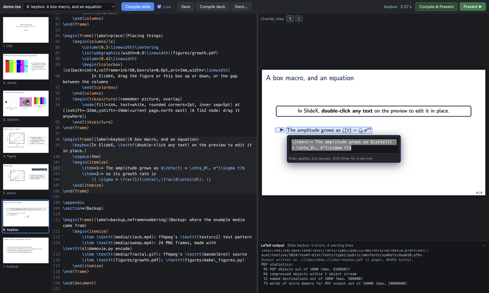

Enter at the end of an `\item`, here or in the code, starts the next item;
Enter on an empty item ends the list.

## Completion

As you type, the editor offers LaTeX and beamer commands, the deck's own
macros (`\newcommand`s in the preamble and in `\input` files), environments
(`\begin` writes the matching `\end`), labels for `\ref` and `\hyperlink`,
figure and movie paths with thumbnails, and options for `\includegraphics` and
`\slidemovie`. Here `\key` offers the deck's `\keybox` macro:

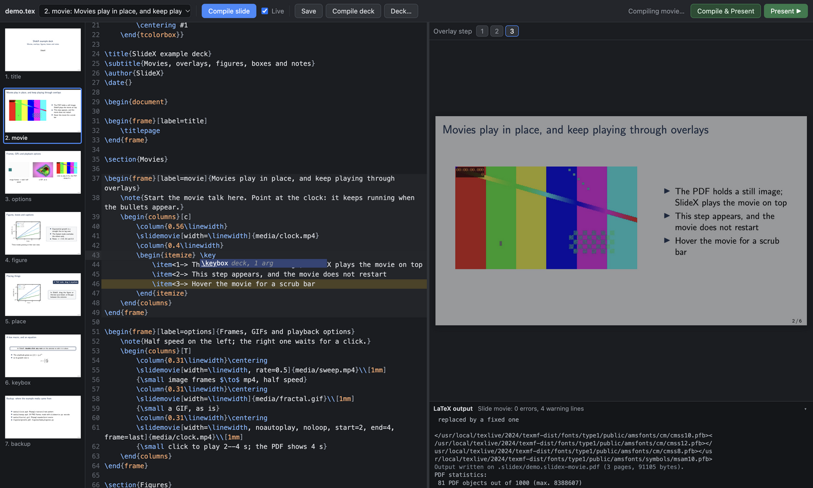

## Resizing figures, movies and boxes

Hover a figure or a movie on the preview and drag its corner handle. The
outline follows the mouse, and on release SlideX rescales the `width=`,
`height=` or `scale=` in the source, keeping your units.

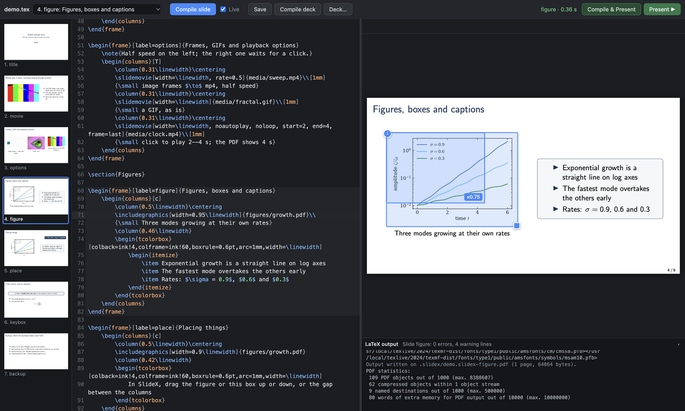

`tcolorbox` environments, and the deck's own box macros (any `\newcommand`
that draws a `tcolorbox`, `\fbox` or `\colorbox`, like the example's
`\keybox`), get a handle on their right edge. A `tcolorbox` gets its `width=`
scaled. A use of a box macro is wrapped in
`\makebox[\linewidth]{\begin{minipage}{0.8\linewidth}...}`, centred, and
resizing it again rescales that width.

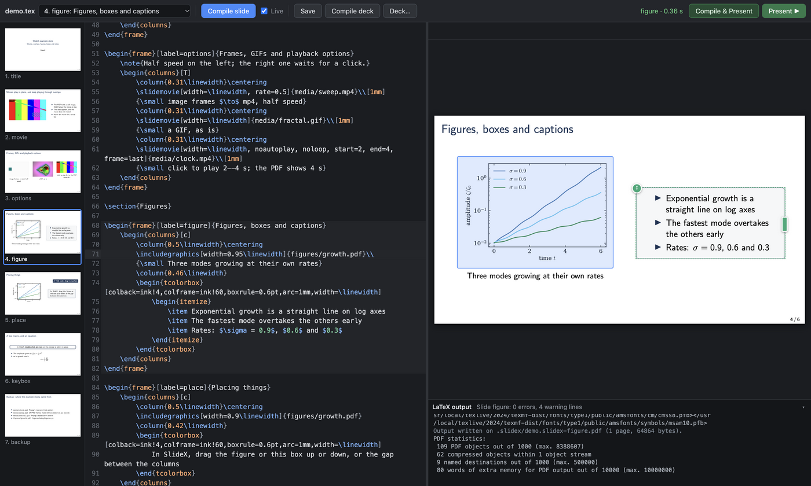

## Moving things

Hover a figure, a box or a TikZ node: a round grip appears at its top-left
corner. Drag it, and SlideX rewrites the source, in its own units. The
example deck's "Placing things" slide has one of each:

- **TikZ nodes placed `at (x,y)`**, in an overlay picture or a normal one, and
  **`textpos` blocks** move anywhere. Their coordinates are rewritten, whether
  they are numbers in the picture's own units (`at (0.5,0.4)` with page
  coordinates, `at (3,2)` in centimetres) or an anchor with shifts
  (`at ([xshift=4mm]current page.center)`). A node placed with an expression
  (`$...$`, polar) is left for you to edit.

  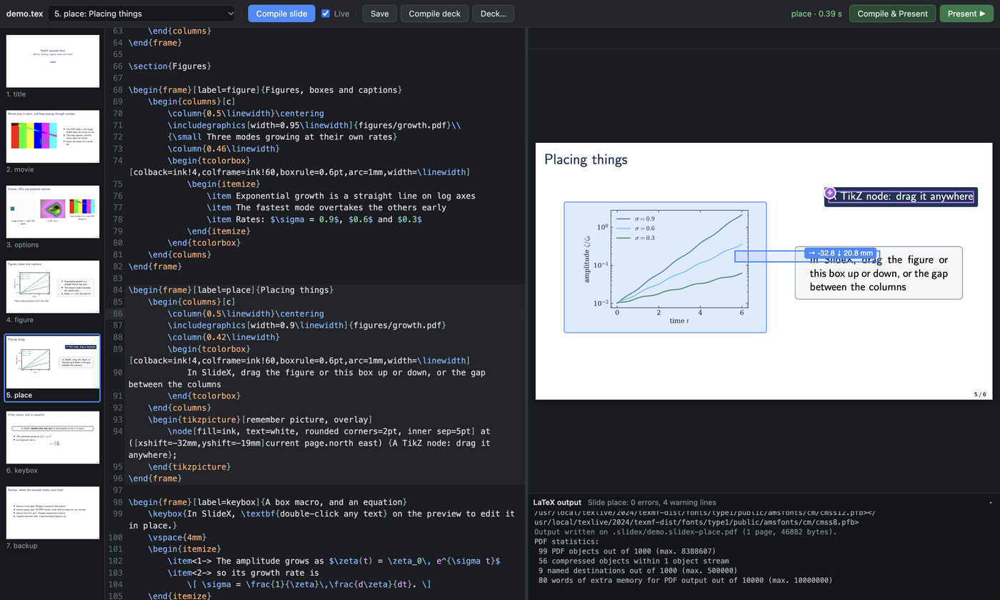

  Dropped, the node's shifts in the code change by what you dragged (here
  `xshift=-32mm,yshift=-19mm` became `xshift=-47.9mm,yshift=-29.6mm`):

  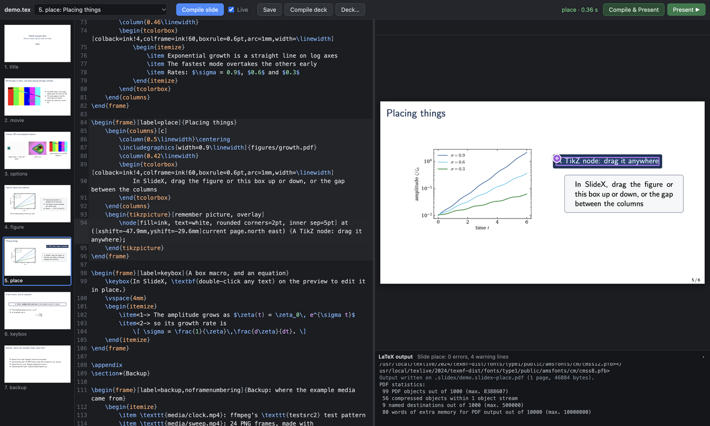
- **Other figures and boxes** move up or down. SlideX puts space above the
  block and takes the same space away below it
  (`\par\vspace{3.5mm}` ... `\par\vspace{-3.5mm}`), so only that block
  moves, even in a vertically centred frame or column. Moving it again changes
  the same two lines; back to zero removes them.

  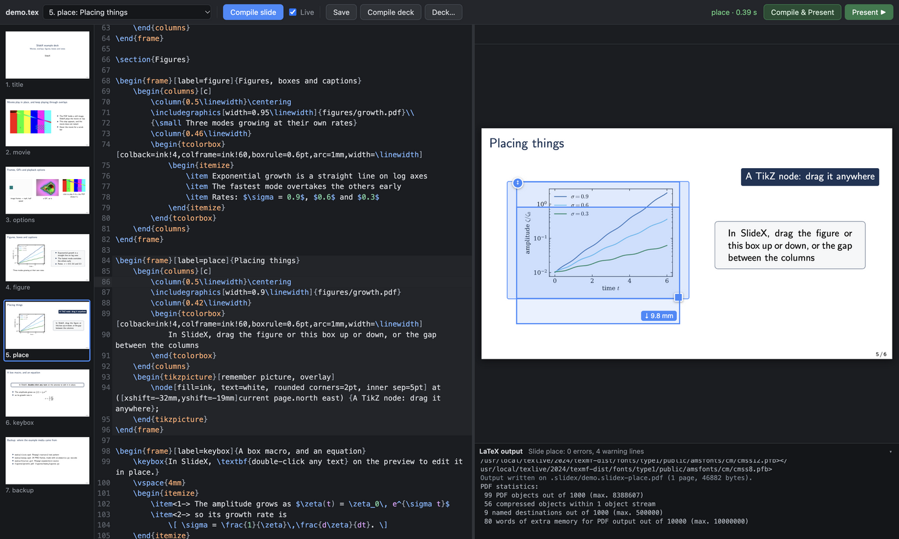
- **Column dividers**: hover the gap between two columns and drag the line to
  shift width from one `\column` to the other (`0.5\linewidth | 0.5\linewidth`
  becomes `0.45\linewidth | 0.55\linewidth`).

  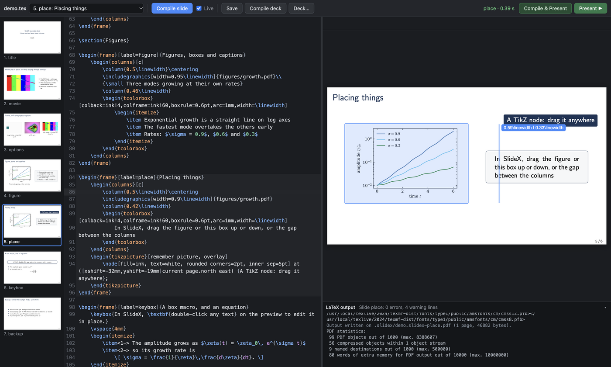

Click a figure or box to select it; the arrow keys then move it by 1 mm
(Shift: 5 mm, Option: 0.25 mm), and Esc deselects. The units come from the
one-slide build itself (it reports the picture's unit vectors and the column
width to its log), so the slide moves by what you dragged, within about a
tenth of a millimetre.

## Deck settings

**Deck…** in the toolbar (or View > Deck Settings, Shift-Cmd-D) opens a panel
beside the slide for the things set in the preamble. Each change is made in
your `.tex` in the editor, so Cmd-Z undoes it and Live shows it on the slide
(a change to the preamble rebuilds the precompiled preamble once, a few
seconds).

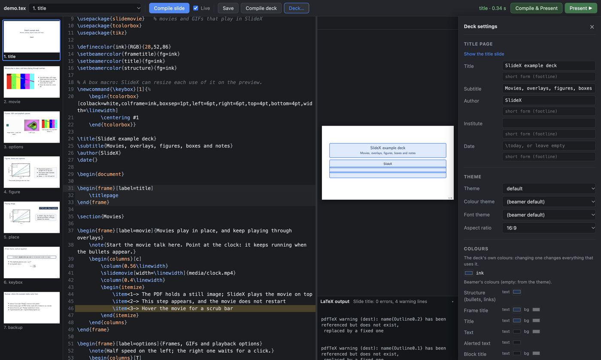

- **Title page:** title, subtitle, author, institute and date, with their short
  forms (used in footlines). The values are LaTeX. If your deck sets them
  through a style package's options (`\usepackage[title={...}]{mystyle}`), the
  panel shows and edits those options.
- **Theme:** theme, colour theme and font theme (the lists are read from your
  TeX installation and the folder), and the aspect ratio.
- **Colours:** every colour the deck defines (`\definecolor`, in the deck, its
  `\input` files or a style beside it). Changing one changes everything that
  uses it: a colour from a style file gets an override line in your preamble,
  and the style file is not touched. Below them, beamer's colour slots (frame
  title, title, text, footline, ...): picking one adds a named colour and a
  `\setbeamercolor` line; ↺ takes it back to the theme's.
- **Header and footer:** footline presets (theme default, none, frame number,
  author · title · n / N), the headline, and navigation symbols.

New lines go before `\begin{document}`, after the rest of the preamble, so
they win; a new theme line goes where the current theme is set.

## Captions

Right-click a figure or a movie for **Add caption** (or **Edit caption**). A
caption is a `{\small ...}` line under it, or `\caption` inside a `figure`
environment.

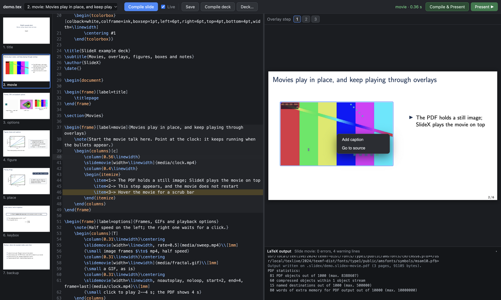

## Adding media

Drop images, movies, GIFs or folders of image frames on the editor. They are
copied into `./figures/` next to the deck, and the `\includegraphics` or
`\slidemovie` line is inserted at the cursor. GIFs and frames become an mp4
with a poster (this needs ffmpeg). Only a movie or GIF adds
`\usepackage{slidemovie}` to the preamble, if the deck does not have it yet;
images use plain `\includegraphics`.

## Errors

LaTeX errors are listed under the preview, marked on their line in the code,
and shown in red in the LaTeX output, with the line numbers of your file.

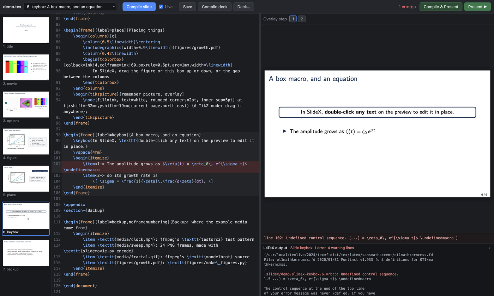

The output box can be resized by dragging its top edge, and collapsed with
the arrow on its right.

## Find and replace

Cmd-F opens a search bar over the code, with replace, regular expressions and
whole-word matching.

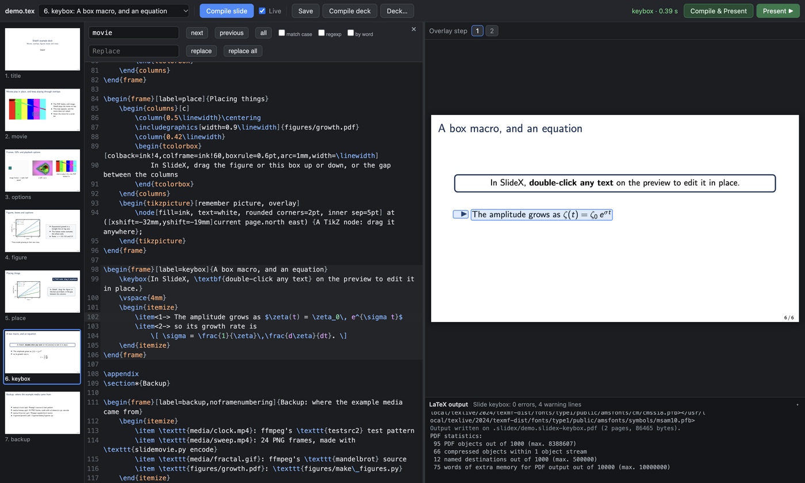

## Light and dark

View > Editor Theme switches the editor between light and dark, or follows
macOS (the default). The choice is kept for the next time.

## Keys

| Key | Action |
|---|---|
| Cmd-Enter | compile the slide under the cursor |
| Shift-Cmd-Enter | compile the deck |
| Cmd-S | save |
| Cmd-E | switch between the editor and the deck |
| Cmd-F | find and replace |
| Cmd-= / Cmd-- / Cmd-0 | bigger, smaller, default code text size |
| arrow keys | move the selected figure or box (Shift: 5 mm, Option: 0.25 mm) |
| Shift-Cmd-D | deck settings |
| Cmd-Z / Shift-Cmd-Z | undo / redo |
