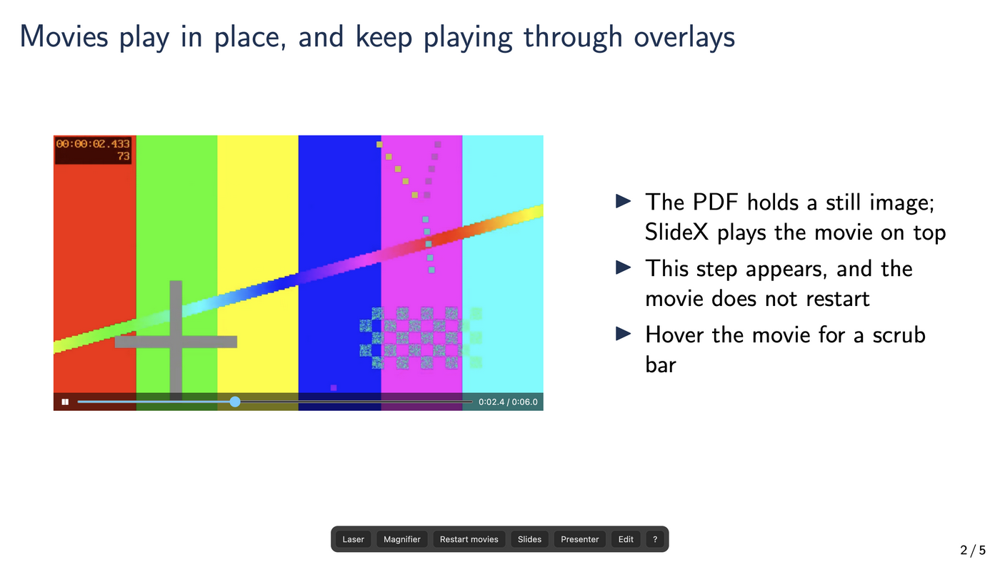
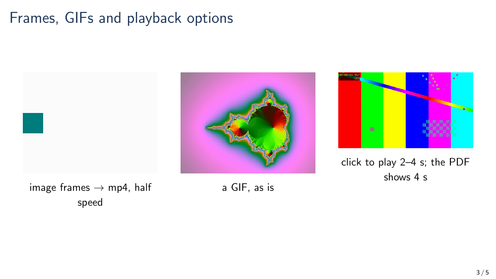

# Movies and GIFs

[Documentation](README.md) > Movies and GIFs

The `slidemovie` LaTeX package puts movies and GIFs on beamer slides. Each
movie is a still **poster** image in the PDF, wrapped in a link that names the
movie file and how to play it. SlideX reads the link and plays the real movie
exactly on top of the poster. Any other PDF viewer (Preview, Skim, Acrobat, a
printer) shows the poster, so the PDF always works.

You only need the package for decks with movies or GIFs. The full reference
is in [latex/README.md](../latex/README.md).

## A movie on a slide

From the example deck's second slide:

```latex
\usepackage{slidemovie}
...
\begin{frame}[label=movie]{Movies play in place, and keep playing through overlays}
	\begin{columns}[c]
		\column{0.56\linewidth}
		\slidemovie[width=\linewidth]{media/clock.mp4}
		\column{0.4\linewidth}
		\begin{itemize}
			\item<1-> The PDF holds a still image; SlideX plays the movie on top
			\item<2-> This step appears, and the movie does not restart
			\item<3-> Hover the movie for a scrub bar
		\end{itemize}
	\end{columns}
\end{frame}
```



The movie plays from the moment the slide appears and keeps going through the
three overlay steps. Paths are relative to the PDF; keep the movies at the
same paths when you move or send the deck.

## Options

The third slide shows a movie made from image frames at half speed, a GIF, and
a clip that waits for a click, plays 2 to 4 s once, and shows its last frame
in the PDF:

```latex
\slidemovie[width=\linewidth, rate=0.5]{media/sweep.mp4}
\slidemovie[width=\linewidth]{media/fractal.gif}
\slidemovie[width=\linewidth, noautoplay, noloop, start=2, end=4, frame=last]{media/clock.mp4}
```



| Option | Meaning |
|---|---|
| `autoplay` / `noautoplay` | start when the slide appears (default), or on a click |
| `loop` / `noloop` | repeat (default), or play once and hold the last frame |
| `rate=0.5` | playback speed |
| `start=2`, `end=4` | play only this window, in seconds |
| `frame=first\|middle\|last\|<seconds>` | the still shown in the PDF |
| `poster=<file>` | use your own still image |
| `slider` | always show the scrub bar |
| `audio` | play with sound (default muted) |
| `continue` / `restart` | on the next overlay step, keep playing (default) or start over |

Anything else (`width`, `height`, `trim`, `clip`, ...) goes to
`\includegraphics` for the poster.

## Posters

The poster is `<movie>.png` (or `<movie>.<frame>.png` for another frame). After
a first LaTeX run, one command makes every poster the deck needs, from the
list LaTeX wrote to `<deck>.smv`:

```bash
pdflatex talk.tex
python3 latex/slidemovie.py posters talk
pdflatex talk.tex
```

The helper needs Python 3 and ffmpeg (`brew install ffmpeg`). It also turns a
GIF or a folder of image frames into an mp4 with its poster:

```bash
python3 latex/slidemovie.py encode anim.gif -o anim.mp4
python3 latex/slidemovie.py encode 'frames/*.png' -o run.mp4 --fps 12
```

In the [editor](editor.md) you can skip all of this: drop a movie, a GIF or a
folder of frames on the editor and SlideX converts it, makes the poster, and
inserts the `\slidemovie` line.

## Sending a deck

```bash
python3 latex/slidemovie.py list talk.pdf    # check that every movie exists
python3 latex/slidemovie.py pack talk.pdf    # PDF + movies + notes in one folder and zip
```

Without SlideX, `slidemovie.py present talk.pdf` presents the deck in a web
browser, movies included, served only to your own machine.
