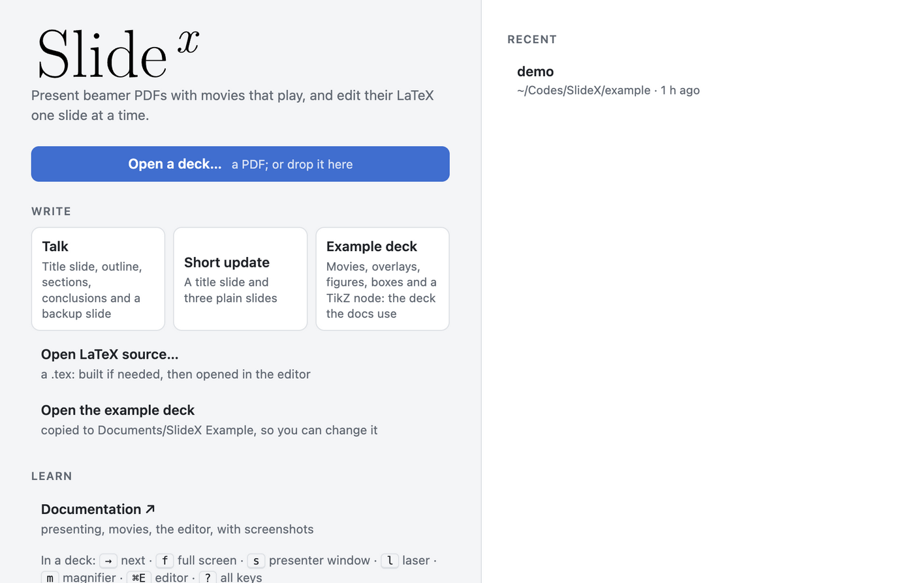
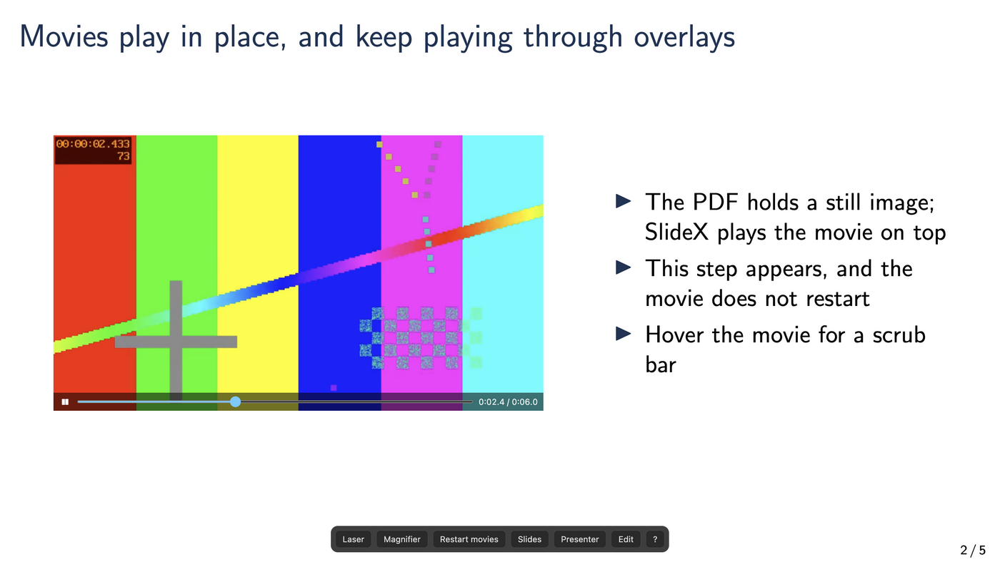
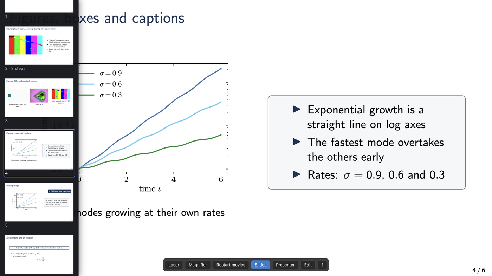
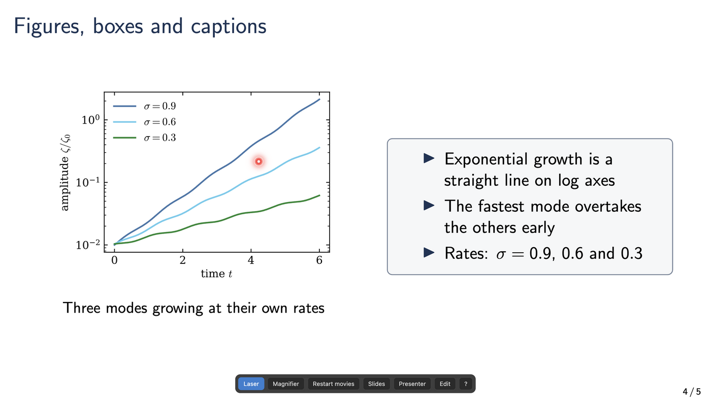
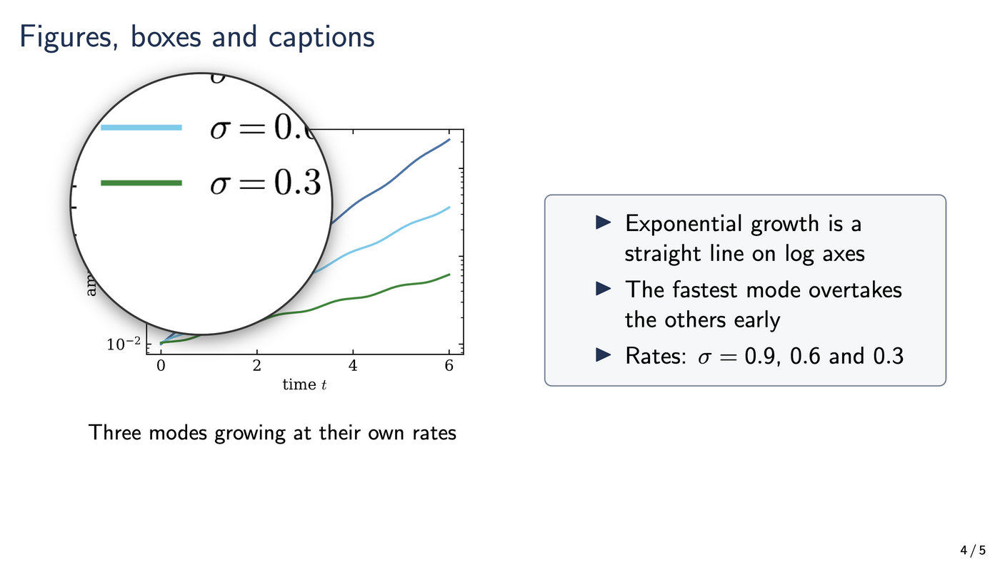
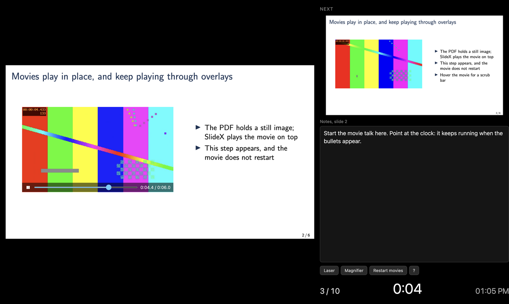

# Presenting

[Documentation](README.md) > Presenting

## Opening a deck

Open a PDF with File > Open (Cmd-O), by dropping it on the window or on the
Dock icon, or with Finder's Open With > SlideX. With nothing open, SlideX
shows its start window:

- **Open a deck** (or drop a PDF anywhere on the window);
- **New deck from a template:** *Talk* (title slide, outline, sections,
  conclusions, a backup slide), *Short update* (a title slide and three plain
  slides) or the *Example deck*. Choose where to save it; SlideX builds it and
  opens it in the [editor](editor.md). The templates are plain beamer, so the
  `.tex` builds anywhere;
- **Open LaTeX source** (built first if its PDF is missing or older);
- **Open the example deck**, copied to `Documents/SlideX Example` so you can
  change it;
- the **documentation**, and the main keys;
- **Recent** decks on the right (× removes one from the list).



Press `f` for full screen. With a projector connected, press `s` for the
presenter window: the slides go full screen on the projector and the
presenter view stays on the laptop. Press `?` at any time for every key.

| Key | Action |
|---|---|
| → ↓ Space PgDn Enter n | next page (clickers send PgDn) |
| ← ↑ PgUp Backspace p | previous page |
| Home / End, *number* Enter | jump |
| f | full screen |
| s | presenter window |
| l | laser pointer |
| m | magnifier; scroll to change its power |
| e | type speaker notes (presenter window); Esc leaves the box |
| click a movie, k | pause or play; a finished clip replays |
| [ / ] | step movies one frame back or forward |
| r | restart this slide's movies |
| b or . / w | black or white screen |
| t | reset the timer |
| Esc | turn off the laser or magnifier, close the help; otherwise leave full screen |

## Before a talk: Check Deck

File > Check Deck… looks at every movie the PDF links to: that it exists, is
readable and inside the folder SlideX serves, and is in a format SlideX plays
(H.264, HEVC, VP8/9 or AV1 in mp4, mov or webm, or a GIF; checked with
`ffprobe` when ffmpeg is installed, else by file name). It also says where the
speaker notes are kept. A movie that would not play gets the command that
fixes it.

## Movies on the slide

Movies placed with the [`slidemovie` package](movies.md) play exactly where
they sit on the slide. On the example deck's second slide the clock keeps
running while the bullets appear one by one: an overlay step does not restart
a movie. Hover a movie for its scrub bar; click it (or press `k`) to pause.



Every other PDF viewer shows a still frame in the same place, so the PDF
still works when you send it to someone without SlideX.

The toolbar at the bottom appears while the mouse moves and fades when it
stops. It holds the laser, the magnifier, Restart movies, the Slides panel,
the presenter window, and Edit (which opens the deck's source in the
[editor](editor.md)).

## Slides panel

**Slides** in the toolbar shows a thumbnail of every slide. Click one to go
there; Esc closes the panel.



## Laser pointer and magnifier

`l` turns the mouse into a laser dot with a short fading tail. It shows on
the projector too, whichever window you point in.



`m` turns on the magnifier: a round lens that redraws the slide sharply at
higher zoom, movies included. Scroll to change its power.



## Presenter window

`s` (or **Presenter** in the toolbar) opens the presenter window: the current
slide, live, with its movies; the next slide; your notes; the slide number,
the timer and the clock. Keys work in either window, and both stay in step.



Click in the notes box (or press `e`) to type a note for the slide; Esc
leaves the box. The note is saved in the deck's `.tex`, as a beamer
`\note{...}` at the top of the slide's frame, so every overlay step shows the
same note:

```latex
\begin{frame}[label=movie]{Movies play in place, and keep playing through overlays}
	\note{Start the movie talk here. Point at the clock: it keeps running when the bullets appear.}
	...
```

- Beamer leaves notes out of the slides (unless you ask for `show notes`), so
  the PDF does not change.
- A note is plain text: characters such as `%`, `$` or `#` are escaped, so
  typing never breaks the build. Notes you wrote yourself as `\note{...}` show
  up too.
- If the editor is open, the note appears in its code as well, so saving the
  editor keeps it.
- A PDF without its `.tex` keeps notes in `<deck>.pdf.notes.json` next to it.
  Notes found there are moved into the `.tex` when it exists.

Decks made with beamer's `show notes on second screen` are split
automatically: the slide half goes to the projector, the notes half to the
presenter window.
